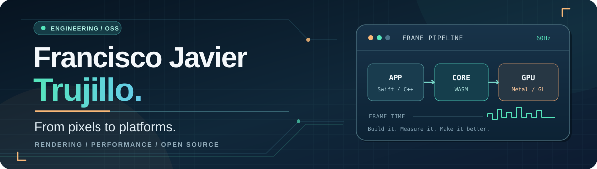
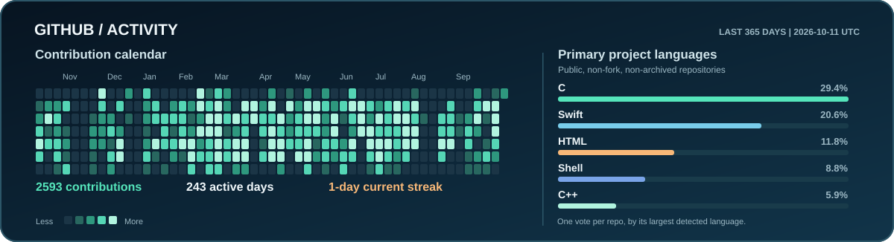
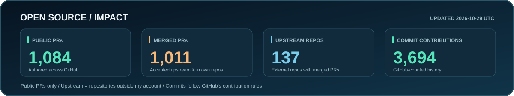

  

  <strong>Senior Software Engineer at <a href="https://www.goodnotes.com/">Goodnotes</a></strong>
  &nbsp;&middot;&nbsp; Cross-platform graphics &amp; systems
  &nbsp;&middot;&nbsp; Málaga, Spain

  <a href="https://www.linkedin.com/in/fjtrujy/">LinkedIn</a>
  &nbsp;&middot;&nbsp;
  <a href="https://x.com/fjtrujy">X / Twitter</a>
  &nbsp;&middot;&nbsp;
  <a href="https://github.com/search?q=author%3Afjtrujy+is%3Apr+is%3Amerged&type=pullrequests">Merged open-source PRs</a>

## I like working where layers meet.

I'm Francisco, a software engineer who enjoys getting from a product idea all the way down to the platform that makes it possible.

At **Goodnotes**, I work on cross-platform rendering: bringing together Swift, WebAssembly, native graphics APIs, and web GPU backends to build fast, consistent drawing experiences. Before that, my work spanned iOS engineering and technical leadership. Across both, I care about performance, maintainable architecture, and helping other engineers ship confidently.

Outside work, I build and maintain open-source projects around **emulation, graphics, console homebrew, and developer tooling**. I especially enjoy the kind of bug that starts as *"the screen occasionally flickers"* and ends in a deep dive through memory, timing, drivers, or a compiler.

**Where I spend my time**

- **Pixels:** Metal, WebGL / WebGPU, graphics pipelines, rendering correctness, and frame-time performance.
- **Platforms:** Swift, C, C++, TypeScript, WebAssembly, constrained devices, and cross-platform architecture.
- **Tools & teams:** CMake, CI, profiling, regression tests, SDKs, code review, and making complex systems easier to work on.

## Things I've built and maintain

### [NJEMU](https://github.com/fjtrujy/NJEMU) — one arcade emulator, several very different machines

A shared C codebase for **PSP, PlayStation 2, PlayStation Vita, and desktop**, running classic Capcom and SNK arcade systems. Much of the interesting work is below the surface: platform drivers, memory-aware caching, graphics backends, audio, timing, and testing across hardware generations.

**[Explore the code](https://github.com/fjtrujy/NJEMU)** · **[Downloads & project site](https://fjtrujy.github.io/NJEMU/)**

### [ps2_drivers](https://github.com/fjtrujy/ps2_drivers) — less boilerplate, more building

A C library that simplifies loading and managing PlayStation 2 IOP/EE drivers. Its goal is practical developer experience: make a famously low-level platform more approachable without hiding how it works.

**[Library & examples](https://github.com/fjtrujy/ps2_drivers)**

### [OpenVCL](https://github.com/fjtrujy/openvcl) — keeping a graphics toolchain alive

Helping modernize the open-source VCL compiler for PlayStation 2 vector units, with a focus on scheduling, measurable output quality, and compatibility with the current PS2 graphics toolchain. Originally created by Jesper Svennevid and Daniel Collin.

**[Compiler source](https://github.com/fjtrujy/openvcl)** · **[PS2GL toolchain integration](https://github.com/ps2dev/ps2gl/pull/28)**

### [Kid Maze](https://github.com/fjtrujy/kidmaze) — a small, different kind of engineering problem

An interactive learning game where children draw directions, letters, or numbers to guide a character through a maze. Built as a lightweight web app, with pen/touch input and on-device recognition.

**[Try it](https://fjtrujy.github.io/kidmaze/)** · **[See the source](https://github.com/fjtrujy/kidmaze)**

## GitHub activity

  

The heatmap shows contributions recorded by GitHub over the last 365 days. Language percentages represent each repository's primary detected language across my public, original, non-archived repositories—not the languages I use most at work.

## Open-source impact

  

Upstream repositories are distinct repositories outside my account where I have a merged public pull request. Commit contributions follow GitHub's contribution rules; they are not a raw count of all Git commits (forks, non-default branches, and private work may not appear). These graphics are [generated from GitHub's API every day](.github/workflows/profile-stats.yml), so the displayed counts reflect the last successful refresh.

## Open source, with receipts

I contribute upstream as well as maintaining my own projects. Here are a few **merged pull requests** that show the kinds of problems I work on:

| Project | What changed |
| :-- | :-- |
| **[PS2SDK](https://github.com/ps2dev/ps2sdk)** | [Fixed speculative block-cache read-ahead and recovery](https://github.com/ps2dev/ps2sdk/pull/935); [exposed useful file I/O block-size information](https://github.com/ps2dev/ps2sdk/pull/929). |
| **[PSP SDK](https://github.com/pspdev/pspsdk)** | [Improved profiling support for PBP and PRX builds](https://github.com/pspdev/pspsdk/pull/347); [improved stdio block-size handling](https://github.com/pspdev/pspsdk/pull/395). |
| **[PS2GL](https://github.com/ps2dev/ps2gl)** | [Migrated builds to CMake and integrated an open VU compilation pipeline](https://github.com/ps2dev/ps2gl/pull/28). |
| **[RetroArch](https://github.com/libretro/RetroArch)** | [Integrated `ps2_drivers` into the PS2 frontend](https://github.com/libretro/RetroArch/pull/14724); [added PS2 resolution changes](https://github.com/libretro/RetroArch/pull/13068). |

**[Browse all my merged pull requests →](https://github.com/search?q=author%3Afjtrujy+is%3Apr+is%3Amerged&type=pullrequests)**

---

I believe good engineering is equal parts curiosity, measurement, and collaboration. If you're building something involving **graphics, performance, emulation, or cross-platform systems**, I'd be happy to compare notes.

**[Connect on LinkedIn](https://www.linkedin.com/in/fjtrujy/)** · **[Find me on GitHub](https://github.com/fjtrujy)** · **[Follow on X](https://x.com/fjtrujy)**
